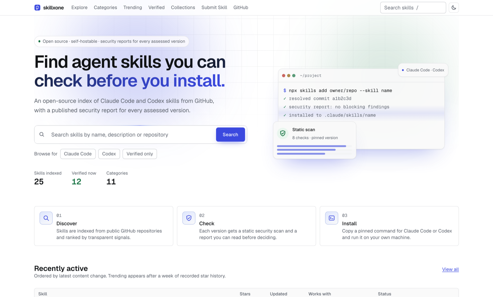
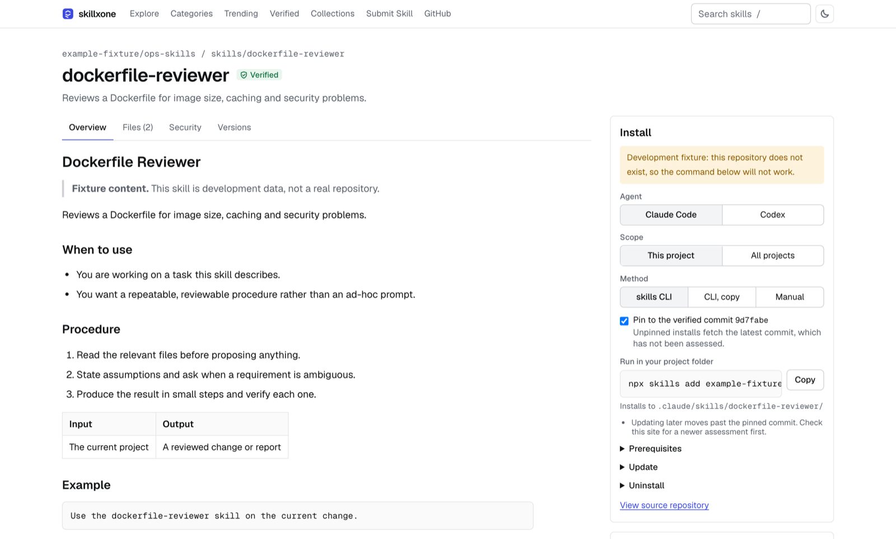
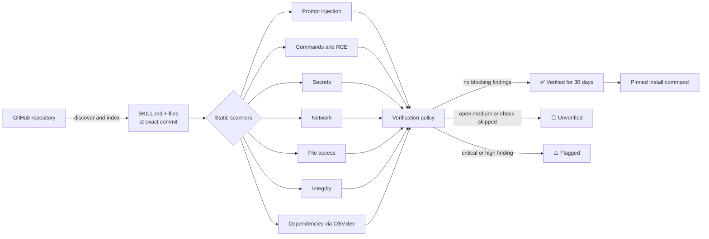

<div align="center">

# skillxone

### The open-source, self-hosted marketplace for AI agent skills, with a security report for every version

Discover, evaluate, verify and install **`SKILL.md` agent skills** for **Claude Code** and **OpenAI Codex** from GitHub. Every assessed version gets a static security scan, a transparent ranking and a pinned install command.

[](https://github.com/oacerxone/skillxone/actions/workflows/ci.yml)
[](https://github.com/oacerxone/skillxone/actions/workflows/security.yml)
[](LICENSE)
[](https://github.com/oacerxone/skillxone/tags)
[](package.json)
[](tsconfig.base.json)
[](docs/architecture/design-system.md)

[Features](#features) · [Get the skill](#get-the-skillxone-skill) · [Quick start](#quick-start) · [How verification works](#how-verification-works) · [Deployment](#deployment) · [API](#rest-api) · [Docs](#documentation) · [Contributing](#contributing)

<br />

<picture>
  <source media="(prefers-color-scheme: dark)" srcset="docs/images/home-dark.png" />
  
</picture>

<sub>Home page running locally with the bundled development fixtures.</sub>

</div>

---

## Why skillxone?

Agent skills are folders of instructions and scripts that an AI coding agent loads and follows. A skill can tell your agent to run commands, read files or fetch URLs, so **installing one is a supply-chain decision**. Most skill directories only list skills. skillxone helps you **check a skill before you install it**:

- **Know what you are installing.** Each indexed version is tied to an exact Git commit and content hash.
- **See the risks.** A static analyzer looks for prompt injection, remote code execution (`curl | sh`), leaked credentials, suspicious network calls, sensitive file access and vulnerable dependencies, and publishes the findings.
- **Install the version that was checked.** Generated commands pin the assessed commit instead of fetching whatever is newest.
- **Own your catalog.** Run it on a small VPS with Node.js and SQLite, as a Docker container, or as a static site. No Redis, no managed database, no paid API.

## Features

|                                    |                                                                                                                                                                                                                 |
| ---------------------------------- | --------------------------------------------------------------------------------------------------------------------------------------------------------------------------------------------------------------- |
| 🔎 **Skill discovery**             | Indexes `SKILL.md` skills from public GitHub repositories, respecting rate limits and ETags. Validates against the open Agent Skills specification.                                                             |
| 🛡️ **Security scanning**           | Seven static scanners plus optional [gitleaks](https://github.com/gitleaks/gitleaks), with context-aware rules that lower severity for quoted, negated or commented text. Untrusted code is **never executed**. |
| ✅ **Verification policy as code** | A published, versioned policy turns findings into **Verified**, **Unverified** or **Flagged**. Verification expires and is re-checked automatically.                                                            |
| 📊 **Transparent ranking**         | Quality, popularity and trend scores from documented signals, with no hidden boosts. Trending uses star history recorded by your own instance.                                                                  |
| ⚡ **Fast search**                 | SQLite FTS5 full-text search with filters for category, agent, verification state and sort order. A `/` shortcut focuses search.                                                                                |
| 📦 **One-click install commands**  | Commands for the open-source [`skills` CLI](https://github.com/vercel-labs/skills) (symlink or copy) or manual install, at project or user scope, with POSIX and PowerShell quoting.                            |
| 🧑‍⚖️ **Moderation and admin**        | GitHub OAuth sign-in, submissions, abuse reports, finding review, an audit log and role-based access with CSRF protection.                                                                                      |
| 🔌 **REST API**                    | A versioned JSON API with an OpenAPI 3.1 document at `/api/v1/openapi.json`.                                                                                                                                    |
| ♿ **Accessible by default**       | WCAG 2.2 AA. Every page is tested with axe-core in light and dark themes on desktop and mobile.                                                                                                                 |
| 🌗 **Polished UI**                 | Next.js App Router, light and dark themes, subtle motion that respects `prefers-reduced-motion`, and a strict nonce-based Content Security Policy.                                                              |

<p align="center">
  
</p>

## Get the skillxone skill

Give **Claude Code** or **OpenAI Codex** the whole verified catalog with one install. Your agent can then search [skillxone.online](https://skillxone.online) and install only skills whose exact version passed the security policy, pinned to the scanned commit, after asking you first.

```bash
npx skills add oacerxone/skillxone --skill skillxone -a claude-code
```

```bash
npx skills add oacerxone/skillxone --skill skillxone -a codex
```

Add `-g` to install for all projects. The skill's source is [skills/skillxone/SKILL.md](skills/skillxone/SKILL.md), and a test runs it through skillxone's own scanner and policy on every change. Setup guide: [skillxone.online/get-skill](https://skillxone.online/get-skill).

## Quick start

**Requirements:** Node.js 22.12+ and pnpm 10 (`corepack enable` provides pnpm).

```bash
git clone https://github.com/oacerxone/skillxone.git
```

```bash
cd skillxone && pnpm install
```

```bash
pnpm dev
```

`pnpm dev` creates `.env`, creates and migrates a SQLite database in `data/`, loads categories and clearly labelled development fixtures, and serves **http://localhost:3000**. The health check is at `/api/health`.

### Index real skills from GitHub

```bash
pnpm worker discover   # queue the seed repositories in catalog/seeds.json
```

```bash
pnpm worker drain      # index, scan and rank everything queued, then exit
```

A `GITHUB_TOKEN` in `.env` (read-only, public repositories) raises the GitHub API rate limit. It is optional.

<details>
<summary><strong>All commands</strong></summary>

| Command                             | Purpose                                                   |
| ----------------------------------- | --------------------------------------------------------- |
| `pnpm test`                         | Unit and integration tests (Vitest)                       |
| `pnpm test:e2e`                     | Browser and accessibility tests (Playwright and axe-core) |
| `pnpm test:static`                  | Export the fixture catalog and test the static site       |
| `pnpm lint` / `pnpm typecheck`      | Static checks (zero warnings allowed)                     |
| `pnpm build`                        | Production build of the web app                           |
| `pnpm worker help`                  | Worker CLI reference                                      |
| `pnpm worker serve`                 | Run schedules and jobs continuously                       |
| `pnpm worker scan owner/repo/skill` | Assess one skill now                                      |
| `pnpm worker backup` / `restore`    | Online SQLite backup and restore                          |
| `pnpm export:static`                | Write the static catalog to `out-static/`                 |

</details>

## How verification works



- **Verified** means one exact version passed the [published policy](docs/security/verification-policy.md). It is **not a guarantee of safety**. It is static analysis, stated plainly.
- Every rule, with its severity and the context that lowers it, is documented in [docs/security/rules.md](docs/security/rules.md).
- Measured false-positive rates on a real catalog of 668 skills are published in [docs/security/live-catalog-review.md](docs/security/live-catalog-review.md).

## Deployment

| Mode                  | Best for                                                 | Needs                                                  |
| --------------------- | -------------------------------------------------------- | ------------------------------------------------------ |
| **A. VPS**            | Full catalog with admin, submissions and scheduled scans | Node.js 22, systemd, Caddy or Nginx                    |
| **B. Docker**         | One container with web and worker                        | Docker or Compose (optional, never required)           |
| **C. Static catalog** | GitHub Pages, Netlify, S3 or any static host             | Nothing at runtime. Client-side search with MiniSearch |

Step-by-step guides: [VPS](docs/deployment/vps.md) · [Docker](docs/deployment/docker.md) · [Static](docs/deployment/static.md) · [Backups](docs/deployment/backup.md) · [Measured resource use](docs/deployment/measurements.md)

## REST API

| Endpoint                                                 | Description                                 |
| -------------------------------------------------------- | ------------------------------------------- |
| `GET /api/v1/skills`                                     | List and filter skills                      |
| `GET /api/v1/skills/{id}/install`                        | Install plan for an agent, scope and method |
| `GET /api/v1/search` · `/suggest`                        | Full-text search and autocomplete           |
| `GET /api/v1/trending` · `/categories` · `/repositories` | Catalog views                               |
| `POST /api/v1/submissions` · `/reports`                  | Submit a repository or report a skill       |
| `GET /api/v1/openapi.json`                               | Full OpenAPI 3.1 specification              |

## Architecture

A **modular monolith** in a TypeScript pnpm monorepo: one Next.js web app, one worker CLI, one database.

```
apps/web               Next.js site, REST API and admin. Reads the database; never calls GitHub in a request.
apps/worker            CLI for migrations, schedules, GitHub sync, scans and backups. The only heavy writer.
packages/security      Static scanners, rule engine and the verification policy as code.
packages/installer     Agent adapters and install-command builder. Produces text, runs nothing.
packages/github        GitHub REST client, rate limiting and discovery providers.
packages/skill-parser  Finds skills, parses and validates SKILL.md, content hashing.
packages/search        Full-text search (SQLite FTS5).
packages/ranking       Pure quality and trend scoring.
packages/database      Kysely schema, migrations, job queue (SQLite by default, PostgreSQL adapter).
packages/shared · ui   Types, env validation and design tokens.
```

**Stack:** TypeScript · Next.js 16 · React 19 · Tailwind CSS 4 · Kysely · SQLite (better-sqlite3, WAL) · Vitest · Playwright · axe-core.

Read more in the [architecture overview](docs/architecture/overview.md) and the [decision records](docs/architecture/decisions.md).

## Security

- Content from GitHub is treated as **untrusted input**. It is never executed, imported or rendered unsanitized.
- The web app **never runs install commands**. It only shows them for you to run.
- Secrets live only in environment variables, and tokens are never logged.
- Sessions store token hashes only, forms use HMAC CSRF tokens and origin checks, and pages use a per-request nonce CSP.
- See the [platform security review](docs/security/platform-review.md). Report vulnerabilities privately as described in [SECURITY.md](SECURITY.md).

## Project status

**v0.1.0-beta.** All ten roadmap phases are implemented and tested: 675 unit and integration tests and 209 browser and accessibility tests. It has not run in production yet. See the [CHANGELOG](CHANGELOG.md) for known limitations and the [roadmap](docs/ROADMAP.md) for what's next.

## Documentation

| Topic        | Document                                                                                                                                                                                                                                   |
| ------------ | ------------------------------------------------------------------------------------------------------------------------------------------------------------------------------------------------------------------------------------------ |
| Architecture | [Overview](docs/architecture/overview.md) · [Decisions](docs/architecture/decisions.md) · [Database schema](docs/architecture/database-schema.md) · [Design system](docs/architecture/design-system.md)                                    |
| Security     | [Verification policy](docs/security/verification-policy.md) · [Scanner rules](docs/security/rules.md) · [Catalog review](docs/security/live-catalog-review.md) · [Platform review](docs/security/platform-review.md)                       |
| Development  | [Ingestion](docs/development/ingestion.md) · [Search and ranking](docs/development/search-and-ranking.md) · [Installer](docs/development/installer.md) · [Worker](docs/development/worker.md) · [Extending](docs/development/extending.md) |
| Operations   | [Deployment](docs/deployment/README.md) · [Troubleshooting](docs/troubleshooting.md)                                                                                                                                                       |

## FAQ

<details>
<summary><strong>What is an agent skill?</strong></summary>

A folder containing a `SKILL.md` file (YAML frontmatter plus Markdown instructions) and optional scripts or reference files. Agents such as Claude Code and OpenAI Codex load the skill when a task matches its description.
</details>

<details>
<summary><strong>Does a "Verified" badge mean a skill is safe?</strong></summary>

No. It means that one exact version passed a published static-analysis policy with no blocking findings. Static analysis can miss things, so always read a skill before you install it.
</details>

<details>
<summary><strong>Can I add support for another AI coding agent?</strong></summary>

Yes. Agents are adapters in `packages/installer/src/agents/`. See [Extending](docs/development/extending.md).
</details>

<details>
<summary><strong>Do I need Docker, Redis or PostgreSQL?</strong></summary>

No. The default is Node.js and a single SQLite file. Docker and PostgreSQL are optional.
</details>

## Contributing

Contributions are welcome: new security rules, discovery providers, agent adapters, documentation and bug fixes. Start with [CONTRIBUTING.md](CONTRIBUTING.md), then see [GOVERNANCE.md](GOVERNANCE.md) and the [Code of Conduct](CODE_OF_CONDUCT.md). To suggest a skill repository, use **Submit Skill** on any running instance or open an issue.

If skillxone is useful to you, please **⭐ star the repository**. It helps other people find it.

## License

[Apache-2.0](LICENSE). Indexed skills remain under their own licenses.

<sub>Keywords: AI agent skills marketplace, Claude Code skills, OpenAI Codex skills, SKILL.md, agent skills directory, AI coding assistant plugins, prompt injection scanner, AI supply chain security, self-hosted, open source, Next.js, SQLite, TypeScript.</sub>
